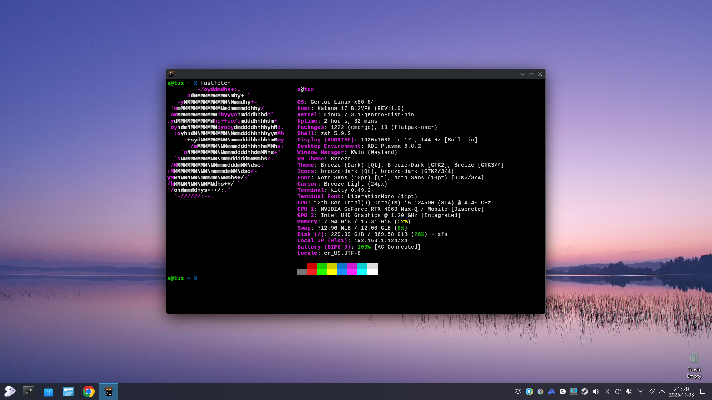

# 

### index
- [why](#why)
- [features](#features)
- [system](#system)
- [contents](#contents)

### why
* keep track of all changes made to my system and resources used along the way
* keep an online/offline copy of the repository on standby as reference
* installing a source based distribution like gentoo and reading docs all day sounded fun

### features
- [x] ~amd64
- [x] bluetooth
- [x] dracut
- [x] flatpak
- [x] gaming (gamescope/steam/wine)
- [x] guru
- [x] hybrid graphics (optimus)
- [x] kernel
- [x] limine
- [x] lvm thin provisioning (2:1)
- [x] networking
- [x] pipewire
- [x] portage optimizations
- [x] power management
- [x] printing
- [x] qemu
- [x] ~~samba~~
- [ ] secure boot
- [x] ssh
- [x] systemd
- [x] ~~tmpfs~~
- [ ] tpm2
- [x] uki
- [x] wayland
- [x] xorg
- [x] zsh
- [x] zswap

### system
* msi katana 17 b12vfk
* 12th gen intel core i5-12450h (alder lake)
* nvidia rtx 4060 laptop gpu
* samsung ddr5 (16gb)
* micron 2400 mtfdkba512qfm nvme (512gb)
* intel ax201

### contents
| system                                                                                                    | purpose |
|-----------------------------------------------------------------------------------------------------------|---------|
| [`boot/limine.conf`][limine.conf]                                                                         | n/a     |
| [`boot/loader/loader.conf`][loader/loader.conf]                                                           | n/a     |
| [`dot/.config/pipewire/pipewire.conf.d/99-input-denoising.conf`][pipewire.conf.d/99-input-denoising.conf] | n/a     |
| [`dot/.config/xdg-desktop-portal/portals.conf`][xdg-desktop-portal/portals.conf]                          | n/a     |
| [`dot/.xinitrc`][.xinitrc]                                                                                | n/a     |
| [`dot/.zprofile`][.zprofile]                                                                              | n/a     |
| [`dot/.zshrc`][.zshrc]                                                                                    | n/a     |
| [`etc/X11/xorg.conf.d/20-intel.conf`][xorg.conf.d/20-intel.conf]                                          | n/a     |
| [`etc/X11/xorg.conf.d/40-libinput.conf`][xorg.conf.d/40-libinput.conf]                                    | n/a     |
| [`etc/dracut.conf.d/dracut.conf`][dracut.conf.d/dracut.conf]                                              | n/a     |
| [`etc/kernel/cmdline`][kernel/cmdline]                                                                    | n/a     |
| [`etc/lvm/lvm.conf`][lvm/lvm.conf]                                                                        | n/a     |
| [`etc/polkit-1/rules.d/49-wheel.rules`][rules.d/49-wheel.rules]                                           | n/a     |
| [`etc/portage/package.use/core`][package.use/core]                                                        | n/a     |
| [`etc/portage/package.use/steam`][package.use/steam]                                                      | n/a     |
| [`etc/portage/repos.conf/eselect-repo.conf`][repos.conf/eselect-repo.conf]                                | n/a     |
| [`etc/portage/make.conf`][portage/make.conf]                                                              | n/a     |
| [`etc/portage/package.accept_keywords`][portage/package.accept_keywords]                                  | n/a     |
| [`etc/portage/package.license`][portage/package.license]                                                  | n/a     |
| [`etc/portage/package.mask`][portage/package.mask]                                                        | n/a     |
| [`etc/udev/rules.d/60-steam-input.rules`][rules.d/60-steam-input.rules]                                   | n/a     |
| [`etc/udev/rules.d/60-steam-vr.rules`][rules.d/60-steam-vr.rules]                                         | n/a     |
| [`etc/udev/rules.d/80-nvidia-pm.rules`][rules.d/80-nvidia-pm.rules]                                       | n/a     |
| [`etc/dispatch-conf.conf`][dispatch-conf.conf]                                                            | n/a     |
| [`etc/doas.conf`][doas.conf]                                                                              | n/a     |
| [`etc/environment`][environment]                                                                          | n/a     |
| [`etc/fstab`][fstab]                                                                                      | n/a     |
| [`etc/hostname`][hostname]                                                                                | n/a     |
| [`etc/hosts`][hosts]                                                                                      | n/a     |
| [`etc/locale.gen`][locale.gen]                                                                            | n/a     |
| [`etc/vconsole.conf`][vconsole.conf]                                                                      | n/a     |
| [`sys/devices/platform/msi-ec/cooler-boost`][msi-ec/cooler_boost]                                         | n/a     |
| [`sys/devices/platform/msi-ec/fan-mode`][msi-ec/fan_mode]                                                 | n/a     |
| [`sys/devices/platform/msi-ec/fn-key`][msi-ec/fn_key]                                                     | n/a     |
| [`sys/devices/platform/msi-ec/shift-mode`][msi-ec/shift_mode]                                             | n/a     |
| [`sys/devices/platform/msi-ec/super-battery`][msi-ec/super_battery]                                       | n/a     |
| [`sys/devices/platform/msi-ec/webcam`][msi-ec/webcam]                                                     | n/a     |
| [`sys/devices/platform/msi-ec/webcam_block`][msi-ec/webcam_block]                                         | n/a     |
| [`sys/devices/platform/msi-ec/win_key`][msi-ec/win_key]                                                   | n/a     |
| [`var/lib/portage/world_wayland`][portage/world_wayland]                                                  | n/a     |
| [`var/lib/portage/world_xorg`][portage/world_xorg]                                                        | n/a     |

| dotfiles                                                     | purpose |
|--------------------------------------------------------------|---------|
| [`dot/.config/fontconfig/fonts.conf`][fontconfig/fonts.conf] | n/a     |
| [`dot/.config/gammastep/config.ini`][gammastep/config.ini]   | n/a     |
| [`dot/.config/gtk-3.0/settings.ini`][gtk-3.0/settings.ini]   | n/a     |
| [`dot/.config/gtk-4.0/settings.ini`][gtk-4.0/settings.ini]   | n/a     |
| [`dot/.config/idesktop/ideskrc`][idesktop/ideskrc]           | n/a     |
| [`dot/.config/labwc/autostart`][labwc/autostart]             | n/a     |
| [`dot/.config/labwc/menu.xml`][labwc/menu.xml]               | n/a     |
| [`dot/.config/labwc/rc.xml`][labwc/rc.xml]                   | n/a     |
| [`dot/.config/sfwbar/sfwbar.config`][sfwbar/sfwbar.config]   | n/a     |
| [`dot/.gtkrc-2.0`][.gtkrc-2.0]                               | n/a     |

---

### fdisk[^1] (gpt)[^2] (outdated)
| device           | alloc      | type      | fs    |
|------------------|------------|-----------|-------|
| `/dev/nvme0n1p1` | 2gb        | efi (1)   | fat32 |
| `/dev/nvme0n1p2` | 474.92gb   | lvm (44)  | xfs   |

> [!TIP]
> to locate/print block device attributes: `blkid`                            \
> to list information about all available or specified block devices: `lsblk` \
> correct gpt pmbr size mismatches by issuing writes to disk

### esp[^3] [^4] and lvm[^8] with swap[^7]
```
#
mkfs.vfat -F 32 /dev/nvme0n1p1

#
pvcreate /dev/nvme0n1p2
vgcreate tux /dev/nvme0n1p2

#
lvcreate -L 12G tux -n swap
mkswap /dev/mapper/tux-swap
swapon /dev/mapper/tux-swap

# 2:1 overprovisioning ratio of 80% reserved thin pool with 2gb metadata in mind:
lvcreate --type thin-pool --poolmetadatasize 2G -l 80%VG -n thin tux
lvcreate -V740G --thinpool tux/thin -n root

#
mkfs.xfs -m finobt=1,reflink=1,rmapbt=1 /dev/mapper/tux-root
```

> [!NOTE]
> for disk encryption with `luks2` by using `dm-crypt` (optional) see below:
> ```
> cryptsetup luksFormat --type luks2 --cipher aes-xts-plain64 --key-size 512 --pbkdf argon2id /dev/nvme0n1p2
> cryptsetup luksOpen /dev/nvme0n1p2 root
> cryptsetup refresh --allow-discards root
> ```
> for configuring `dm-integrity` by using `integritysetup` (recommended) see below:
> ```
> integritysetup format /dev/nvme0n1p2
> integritysetup open /dev/nvme0n1p2 root
> ```

> [!TIP]
> to list all active physical volumes: `pvdisplay` \
> if physical volumes are missing: `pvscan`        \
> to list all active volume groups: `vgdisplay`    \
> if volume groups are missing: `vgscan`           \
> to list all logical volumes: `lvdisplay`         \
> if logical volumes are missing: `lvscan`

---

### portage[^9]
| command                                                                      | functionality                                                                                           |
|------------------------------------------------------------------------------|---------------------------------------------------------------------------------------------------------|
| `dispatch-conf`                                                              | manage configuration changes after an emerge completes                                                  |
| `getuto`                                                                     | get portage to set up the necessary keyring for verification when using binaries                        |
| `emerge --sync`                                                              | sync all repositories that are set to auto-sync including the gentoo ebuild repository                  |
| `emerge-webrsync`                                                            | sync the gentoo ebuild repository using the mirrors by obtaining a snapshot that is (at most) a day old |
| `emerge --ask --verbose --update --deep --newuse --with-bdeps=y @world`      | |
| `emerge --ask --verbose --update --deep --changed-use --with-bdeps=y @world` | |
| `emerge --ask --depclean`                                                    | |
| `emerge --ask @module-rebuild`                                               | after installing a new kernel                                                                           |
| `emerge --ask @preserved-rebuild`                                            | for using new libraries                                                                                 |

---

### mounting devices
```
mkdir -p /mnt/gentoo
mount /dev/mapper/tux-root /mnt/gentoo

mkdir -p /mnt/gentoo/boot
mount /dev/nvme0n1p1 /mnt/gentoo/boot
```

### configuring network
```
ip link show
net-setup wlo1
ping -c 3 1.1.1.1
```

> [!TIP]
> for automatic ip, network mask, routes, dns and ntp servers: `dhcpcd enp3s0/wlo1` \
> for network card activation: `ifconfig -v wlo1 up` / `ip link set wlo1 up`

### stage3
```
cd /mnt/gentoo
wget https://ftp.lysator.liu.se/gentoo/releases/amd64/autobuilds/current-stage3-amd64-desktop-systemd/stage3-amd64-desktop-systemd-xxxxxxxxxxxxxxxx.tar.xz
tar xpvf stage3-*.tar.xz --xattrs-include='*.*' --numeric-owner -C /mnt/gentoo
cp --dereference /etc/resolv.conf /mnt/gentoo/etc/
```

---

### mounting filesystems
```
mount --types proc /proc /mnt/gentoo/proc
mount --rbind /sys /mnt/gentoo/sys
mount --make-rslave /mnt/gentoo/sys
mount --rbind /dev /mnt/gentoo/dev
mount --make-rslave /mnt/gentoo/dev
mount --bind /run /mnt/gentoo/run
mount --make-slave /mnt/gentoo/run
```

### chrooting[^10] into environment
```
chroot /mnt/gentoo /bin/bash
source /etc/profile
export PS1="(chroot) ${PS1}"
```

> [!NOTE]
> using `arch-chroot /mnt/gentoo` simplifies the mounting process of necessary filesystems when using the official gentoo installation media:
> ```
> dd if=install-amd64-minimal-xxxxxxxxxxxxxxxx.iso of=/dev/sda bs=4096 status=progress && sync
> ```

> [!TIP]
> to specify input file: `if=`                                    \
> to specify output file: `of=` (which in this case, is a device) \
> to speed up transfers in most cases: `bs=4096`                  \
> to display transfers stats: `status=progress`

---

### installing base system
```
emerge --sync
getuto
env-update && source /etc/profile
emerge --ask --verbose --update --deep --changed-use --with-bdeps=y @world
emerge --ask --depclean
```

> [!TIP]
> for detecting cpu: `resolve-march-native --drop-cache-sizes`                                                         \
> for detecting cpu features: `cpuid2cpuflags`                                                                         \
> to select hostname for the system: `echo tux > /etc/hostname`                                                        \
> to select timezone for the system: `ln -sf ../usr/share/zoneinfo/Europe/Stockholm /etc/localtime`                    \
> to select profile for the system (__eselect__): `eselect profile list` / `eselect profile set <value>`               \
> to select locale for the system (__eselect__): `eselect locale list` / `eselect locale set <value>`                  \
> to select locale for the system (__localectl__): `localectl list-locales` / `localectl set-locale <value>`           \
> to select keyboard layout for the console (__localectl__): `localectl list-keymaps` / `localectl set-keymap <value>` \
> to generate all locales specified in the /etc/locale.gen file: `locale-gen`

### installing firmware[^11] [^12] [^13], bootloader[^14] and kernel[^15]
```
mkdir -p /etc/cmdline.d
ln -s /etc/kernel/cmdline /etc/cmdline.d/00-installkernel.conf

emerge --ask sys-kernel/linux-firmware sys-kernel/linux-headers sys-firmware/intel-microcode sys-firmware/sof-firmware
emerge --ask app-crypt/sbsigntools sys-apps/fwupd sys-apps/pciutils sys-apps/systemd sys-kernel/dkms sys-kernel/dracut sys-kernel/gentoo-sources sys-kernel/installkernel
emerge --ask app-arch/zstd sys-block/io-scheduler-udev-rules sys-fs/dosfstools sys-fs/e2fsprogs sys-fs/lvm2 sys-fs/ntfs3g sys-fs/xfsprogs

# (skip unless you're not opting to use distribution kernels)
ln -sf /usr/src/linux-<version>-gentoo /usr/src/linux
cd /usr/src/linux

make localmodconfig
make && make modules_install
emerge --ask @module-rebuild
make install

emerge --ask sys-boot/limine
mkdir -p /boot/EFI/BOOT
cp -v /usr/share/limine/BOOTX64.EFI /boot/EFI/BOOT/
```

> [!NOTE]
> `modprobed-db` is useful for building a minimal kernel with `make localmodconfig` and \
> works best by using the distribution kernel for about a month and have the utility run in the background so it can have time to learn what modules the system needs:
> ```
> # to simplify the kernel setup and avoid configuration by hand,
> # modify 'etc/portage/make.conf' and add 'dist-kernel' to your use flags.
> # at this point, freely skip some steps outlined under section(s) 'installing firmware, bootloader and kernel'.
>
> # to use the distribution kernel with gentoo patches from source:
> emerge --ask sys-kernel/gentoo-kernel
> emerge --config sys-kernel/gentoo-kernel
> 
> # to use the precompiled distribution kernel:
> emerge --ask sys-kernel/gentoo-kernel-bin
> emerge --config sys-kernel/gentoo-kernel-bin
>
> emerge --ask sys-kernel/modprobed-db
> modprobed-db store
> modprobed-db recall
> make LSMOD=$HOME/.config/modprobed.db localmodconfig
> ```

> [!TIP]
> for selecting kernel and symlinking: `eselect kernel list` / `eselect kernel set <index>`         \
> to show symlink(s) of given directory: `ls -l <dir>`                                              \
> to manually configure the kernel: `make nconfig`                                                  \
> to manually configure the kernel using ncurses: `make menuconfig`                                 \
> to regenerate initramfs images with kernel versions found on system: `dracut -f --regenerate-all` \
> to regenerate initramfs image with current kernel version: `dracut -f --kver $(uname -r)`

---

### systemd[^16]
| services                               | sockets                     | timers             |
|----------------------------------------|-----------------------------|--------------------|
| `acpid.service (#)`                    | `pipewire-pulse.socket ($)` | `fstrim.timer (#)` |
| `bluetooth.service (#)`                | ~~`pulseaudio.socket ($)`~~ | |
| `cups.service (#)`                     | `virtstoraged.socket (#)`   | |
| `dkms.service (#)`                     | |
| ~~`dnsmasq.service (#)`~~              | |
| `gammastep.service (?)`                | |
| `getty@tty1.service (#)`               | |
| `libvirtd.service (#)`                 | |
| `lvm2-monitor.service (#)`             | |
| `modprobed-db.service ($)`             | |
| `NetworkManager.service (#)`           | |
| ~~`nmbd.service (#)`~~                 | |
| ~~`pulseaudio.service ($)`~~           | |
| `sddm.service (#)`                     | |
| ~~`smbd.service (#)`~~                 | |
| `sshd.service (#)`                     | |
| ~~`systemd-boot-update.service (#)`~~  | |
| ~~`systemd-modules-load.service (#)`~~ | |
| ~~`systemd-networkd.service (#)`~~     | |
| `systemd-timesyncd.service (#)`        | |
| `thermald.service (#)`                 | |
| `tlp.service (#)`                      | |
| `virtnetworkd.service (#)`             | |
| `virtqemud.service (#)`                | |
| `virtlogd.service (#)`                 | |
| `wireplumber.service ($)`              | |

### configuring systemd
```
systemd-machine-id-setup
systemd-firstboot --prompt
systemctl preset-all --preset-mode=enable-only
systemctl preset-all
```

> [!NOTE]
> when using `systemd` the `/tmp` directory is mounted by default as `tmpfs` and
> in order to disable this behavior and take back control of the directory by using `/etc/fstab` issue the following command:
> ```
> systemctl mask tmp.mount
> ```
> in the unlikely event that the entire `/var/tmp/` directory is already mounted as `tmpfs`, edit `/etc/fstab` accordingly:
> ```
> echo "tmpfs /var/tmp          tmpfs  rw,nosuid,nodev,size=50%,mode=1777                                           0       0" >> /etc/fstab
> echo "tmpfs /var/tmp/portage  tmpfs  rw,nosuid,nodev,size=50%,mode=775,uid=portage,gid=portage,x-mount.mkdir=775  0       0" >> /etc/fstab
> mount /var/tmp/portage
> ```

> [!TIP]
> to enable unit to start automatically at boot: `systemctl enable .service/.socket` \
> to start unit immediately: `systemctl start .service/.socket/.timer`               \
> to select the hostname for the system: `hostnamectl hostname tux`                  \
> to select the timezone for the system: `timedatectl set-timezone Europe/Stockholm` \
> to clean up core dumps manually: `systemd-tmpfiles --clean`

### journalctl [^17]
| command                      | functionality                                                                                          |
|------------------------------|--------------------------------------------------------------------------------------------------------|
| `journalctl --disk-usage`    | shows the current disk usage of all journal files                                                      |
| `journalctl --vacuum-files=` | leaves only the specified number of separate journal files                                             |
| `journalctl --vacuum-size=`  | removes the oldest archived journal files until the disk space they use falls below the specified size |
| `journalctl --vacuum-time=`  | removes archived journal files older than the specified timespan                                       |

---

### system groups[^18]
| group      | permissions                                                                                   |
|------------|-----------------------------------------------------------------------------------------------|
| `android`  | |
| `audio`    | direct access to sound hardware, for all sessions                                             |
| `kvm`      | access to virtual machines using kvm                                                          |
| `libvirt`  | users in this group can talk with libvirt service via dbus                                    |
| `pipewire` | |
| `plugdev`  | allows members to mount and umount removable devices through pmount                           |
| `users`    | the primary group for users when user private groups are not used (generally not recommended) |
| `video`    | access to video capture devices, 2d/3d hardware acceleration and framebuffer                  |
| `wheel`    | administration group, commonly used to give privileges to perform administrative actions      |

### creating user
```
emerge --ask app-admin/doas
useradd -mG android,audio,kvm,libvirt,pipewire,plugdev,users,video,wheel <user>
passwd <user>
touch /etc/doas.conf
echo "permit persist :wheel" >> /etc/doas.conf
chmod -c 0400 /etc/doas.conf
```

> [!CAUTION]
> assuming `app-admin/sudo` is installed and used, `/etc/sudoers` should always be edited with `visudo`. \
> allow members of group wheel sudo access by uncommenting:
> ```
> %wheel ALL=(ALL:ALL) ALL
> ```

> [!TIP]
> to add pre-existing user to a group: `usermod -aG <group> <user>` \
> to delete the root password and disable login: `passwd -dl root`

---

### finishing up
```
exit
umount -l /mnt/gentoo/dev{/shm,/pts,}
umount -R /mnt/gentoo 
reboot
```

> [!TIP]
> to activate/disable volume group: `vgchange -ay <vg_name>` / `vgchange -an <vg_name>`   \
> to activate/disable logical volume: `lvchange -ay <lv_name>` / `lvchange -an <lv_name>`

### eclean[^19] and eclean-kernel
```
emerge --ask app-admin/eclean-kernel app-portage/gentoolkit
eclean-dist -d
eclean-kernel -n 1
eclean-pkg
```

> [!CAUTION]
> by default, source files are located in /var/cache/distfiles, while binary packages are located in /var/cache/binpkgs. \
> both locations can grow quite big if not periodically cleaned.
> 
> be sure to check the boot entries after issuing: `eclean-kernel -n 1`.                                                 \
> it may be empty, and you will only be able to rewrite the boot entry through a livecd.

---

### personal ebuild repositories
```
#
emerge --ask app-eselect/eselect-repository
eselect repository remove -f gentoo
eselect repository add gentoo git https://github.com/gentoo-mirror/gentoo
emaint sync -r gentoo

#
eselect repository enable guru
emaint sync -r guru
emerge --ask app-misc/github-desktop-bin

#
eselect repository enable steam-overlay
emaint sync -r steam-overlay
emerge --ask games-util/steam-launcher

#
eselect repository enable tatsh-overlay
emaint sync -r tatsh-overlay
emerge --ask app-misc/mcontrolcenter

#
eselect repository enable hossie
emaint sync -r hossie
emerge --ask app-misc/claude-desktop-official
```

### zsh, nvidia, pipewire, virtualization[^20] (needs updating)
```
#
emerge --ask app-shells/zsh app-shells/zsh-completions app-shells/gentoo-zsh-completions
sh -c "$(curl -fsSL https://raw.githubusercontent.com/ohmyzsh/ohmyzsh/master/tools/install.sh)"
chsh -s /bin/zsh

#
emerge --ask media-video/pipewire sys-auth/rtkit x11-drivers/nvidia-drivers

#
emerge --ask app-emulation/libvirt app-emulation/qemu app-emulation/wine-staging app-emulation/winetricks
winecfg
winetricks directplay mfc42 dxvk vkd3d quartz
echo "ntsync" | doas tee /etc/modules-load.d/ntsync.conf

#
curl -fsSL https://claude.ai/install.sh | bash
curl -fsSL https://ollama.com/install.sh | sh
ollama run qwen3.5
```

### flatpak (kde integration)
```
#
emerge --ask sys-apps/flatpak kde-plasma/flatpak-kcm
flatpak remote-add --user --if-not-exists flathub https://dl.flathub.org/repo/flathub.flatpakrepo

#
flatpak --user install flathub app.fluxer.Fluxer

#
wget https://github.com/storytold/craft-launcher/releases/download/v0.12.0/artcraft-launcher-0.12.0-linux-x86_64.flatpak
flatpak --user install artcraft-launcher-0.12.0-linux-x86_64.flatpak
```

### rust/rustup
```
#
emerge --ask dev-util/rustup
rustup-init-gentoo --symlink

#
curl --proto '=https' --tlsv1.2 -sSf https://sh.rustup.rs | sh
rustup toolchain link system /usr
```

### msi-ec
```
#
git clone https://github.com/BeardOverflow/msi-ec.git
cd msi-ec
make dkms-install
```
---

> [!CAUTION]  
> file configurations and design choices are strictly made with hardware and preference(s) of mine in mind. \
> read the sources listed throughout the guide for best practices to fully grasp the underlying concepts used throughout the guide!
> ```
> # apply repo-specific configurations by cloning the repo and cd into it:
> git clone https://github.com/librazhd7/gentoo7.git
> cd gentoo7-main
>
> #
> wget https://github.com/librazhd7/gentoo7/archive/refs/heads/main.zip
> unzip gentoo7-main.zip
>
> # grant execute permission and run automated setup (unsafe, work in progress):
> chmod +x ./setup.sh && ./setup.sh
>
> # for @world set with wayland in mind (manual):
> mv -i gentoo7-main/var/lib/portage/world_wayland /var/lib/portage/world
>
> # for @world set with x11 in mind (manual):
> mv -i gentoo7-main/etc/X11/xorg.conf.d/20-intel.conf /etc/X11/xorg.conf.d/20-intel.conf
> mv -i gentoo7-main/etc/X11/xorg.conf.d/40-libinput.conf /etc/X11/xorg.conf.d/40-libinput.conf
> mv -i gentoo7-main/var/lib/portage/world_xorg /var/lib/portage/world
> ```

---

### to do
- proper referencing to docs & files in the repository
- make an index to navigate the readme fully
- make a section for explaining the functionality and relation of every custom file
- scripts for installing and configuring gentoo automatically
- more emphasis on minimal packages by use flags
- binary gentoo package setup
- document commands more and why they're issued

### docs
- [__acpi__][docs/acpi]
- [__alsa__][docs/alsa]
- [__backlight__][docs/backlight] (arch)
- [__bash__][docs/bash]
- [__bluetooth__][docs/bluetooth]
- [__dispatch-conf__][docs/dispatch-conf]
- [__dnsmasq__][docs/dnsmasq]
- [__dracut__][docs/dracut]
- [__eselect__][docs/eselect]
- [__fonts__][docs/fonts]
- [__fwupd__][docs/fwupd]
- [__gamescope__][docs/gamescope] (arch)
- [__gcc optimization__][docs/gcc_optimization]
- [__gentoolkit__][docs/gentoolkit]
- [__git__][docs/git]
- [__guru__][docs/guru]
- [__hybrid graphics__][docs/hybrid_graphics]
- [__libinput__][docs/libinput]
- [__libvirt__][docs/libvirt]
- [__lto__][docs/lto]
- [__networkmanager__][docs/networkmanager]
- [__nvidia-drivers__][docs/nvidia-drivers]
- [__optimus__][docs/optimus]
- [__pipewire__][docs/pipewire]
- [__power management__][docs/power_management]
- [__printing__][docs/printing]
- [__qemu__][docs/qemu]
- [__rust__][docs/rust]
- [__safe cflags__][docs/safe_cflags]
- [__samba__][docs/samba]
- [__secure boot__][docs/secure_boot]
- [__ssh__][docs/ssh]
- [__steam__][docs/steam]
- [__tmpfs__][docs/tmpfs]
- [__tpm__][docs/tpm]
- [__udev__][docs/udev]
- [__unified kernel image__][docs/uki]
- [__wine__][docs/wine]
- [__xdg-desktop-portal__][docs/xdg-desktop-portal]
- [__xfs__][docs/xfs]
- [__xorg__][docs/xorg]
- [__zsh__][docs/zsh]
- [__zswap__][docs/zswap]

<!-- docs -->
[docs/acpi]:                 <https://wiki.gentoo.org/wiki/ACPI>
[docs/alsa]:                 <https://wiki.gentoo.org/wiki/ALSA>
[docs/backlight]:            <https://wiki.archlinux.org/title/Backlight>
[docs/bash]:                 <https://wiki.gentoo.org/wiki/Bash>
[docs/bluetooth]:            <https://wiki.gentoo.org/wiki/Bluetooth>
[docs/dispatch-conf]:        <https://wiki.gentoo.org/wiki/Dispatch-conf>
[docs/dnsmasq]:              <https://wiki.gentoo.org/wiki/Dnsmasq>
[docs/dracut]:               <https://wiki.gentoo.org/wiki/Dracut>
[docs/eselect]:              <https://wiki.gentoo.org/wiki/Eselect>
[docs/fonts]:                <https://wiki.gentoo.org/wiki/Fonts>
[docs/fwupd]:                <https://wiki.gentoo.org/wiki/Fwupd>
[docs/gamescope]:            <https://wiki.archlinux.org/title/Gamescope>
[docs/gcc_optimization]:     <https://wiki.gentoo.org/wiki/GCC_optimization>
[docs/gentoolkit]:           <https://wiki.gentoo.org/wiki/Gentoolkit>
[docs/git]:                  <https://wiki.gentoo.org/wiki/Git>
[docs/guru]:                 <https://wiki.gentoo.org/wiki/Project:GURU>
[docs/hybrid_graphics]:      <https://wiki.gentoo.org/wiki/Hybrid_graphics>
[docs/intel]:                <https://wiki.gentoo.org/wiki/Intel>
[docs/kernel]:               <https://wiki.gentoo.org/wiki/Kernel>
[docs/libinput]:             <https://wiki.gentoo.org/wiki/Libinput>
[docs/libvirt]:              <https://wiki.gentoo.org/wiki/Libvirt>
[docs/linux_firmware]:       <https://wiki.gentoo.org/wiki/Linux_firmware>
[docs/lto]:                  <https://wiki.gentoo.org/wiki/LTO>
[docs/lvm]:                  <https://wiki.gentoo.org/wiki/LVM>
[docs/microcode]:            <https://wiki.gentoo.org/wiki/Microcode>
[docs/networkmanager]:       <https://wiki.gentoo.org/wiki/NetworkManager>
[docs/nvidia-drivers]:       <https://wiki.gentoo.org/wiki/NVIDIA/nvidia-drivers>
[docs/optimus]:              <https://wiki.gentoo.org/wiki/NVIDIA/Optimus>
[docs/pipewire]:             <https://wiki.gentoo.org/wiki/PipeWire>
[docs/power_management]:     <https://wiki.gentoo.org/wiki/Power_management>
[docs/printing]:             <https://wiki.gentoo.org/wiki/Printing>
[docs/qemu]:                 <https://wiki.gentoo.org/wiki/QEMU>
[docs/rust]:                 <https://wiki.gentoo.org/wiki/Rust>
[docs/safe_cflags]:          <https://wiki.gentoo.org/wiki/Safe_CFLAGS>
[docs/samba]:                <https://wiki.gentoo.org/wiki/Samba>
[docs/secure_boot]:          <https://wiki.gentoo.org/wiki/Secure_Boot>
[docs/ssh]:                  <https://wiki.gentoo.org/wiki/SSH>
[docs/steam]:                <https://wiki.gentoo.org/wiki/Steam>
[docs/swap]:                 <https://wiki.gentoo.org/wiki/Swap>
[docs/systemd]:              <https://wiki.gentoo.org/wiki/Systemd>
[docs/systemd-boot]:         <https://wiki.gentoo.org/wiki/Systemd/systemd-boot>
[docs/tmpfs]:                <https://wiki.gentoo.org/wiki/Portage_TMPDIR_on_tmpfs>
[docs/tpm]:                  <https://wiki.gentoo.org/wiki/Trusted_Platform_Module>
[docs/udev]:                 <https://wiki.gentoo.org/wiki/Udev>
[docs/uefi]:                 <https://wiki.gentoo.org/wiki/UEFI>
[docs/uki]:                  <https://wiki.gentoo.org/wiki/Unified_kernel_image>
[docs/wine]:                 <https://wiki.gentoo.org/wiki/Wine>
[docs/xdg-desktop-portal]:   <https://wiki.gentoo.org/wiki/XDG/xdg-desktop-portal>
[docs/xfs]:                  <https://wiki.gentoo.org/wiki/XFS>
[docs/xorg]:                 <https://wiki.gentoo.org/wiki/Xorg>
[docs/zsh]:                  <https://wiki.gentoo.org/wiki/Zsh>
[docs/zswap]:                <https://wiki.gentoo.org/wiki/Zswap>

<!-- * -->
[limine.conf]:  <https://github.com/librazhd7/gentoo7/blob/main/boot/limine.conf>
[loader/loader.conf]:  <https://github.com/librazhd7/gentoo7/blob/main/boot/loader/loader.conf>
[xorg.conf.d/20-intel.conf]:  <https://github.com/librazhd7/gentoo7/blob/main/etc/X11/xorg.conf.d/20-intel.conf>
[xorg.conf.d/40-libinput.conf]:  <https://github.com/librazhd7/gentoo7/blob/main/etc/X11/xorg.conf.d/40-libinput.conf>
[dracut.conf.d/dracut.conf]:  <https://github.com/librazhd7/gentoo7/blob/main/etc/dracut.conf.d/dracut.conf>
[kernel/cmdline]:  <https://github.com/librazhd7/gentoo7/blob/main/etc/kernel/cmdline>
[lvm/lvm.conf]:  <https://github.com/librazhd7/gentoo7/blob/main/etc/lvm/lvm.conf>
[rules.d/49-wheel.rules]: <https://github.com/librazhd7/gentoo7/blob/main/etc/polkit-1/rules.d/49-wheel.rules>
[package.use/core]:  <https://github.com/librazhd7/gentoo7/blob/main/etc/portage/package.use/core>
[package.use/steam]:  <https://github.com/librazhd7/gentoo7/blob/main/etc/portage/package.use/steam>
[repos.conf/eselect-repo.conf]: <https://github.com/librazhd7/gentoo7/blob/main/etc/portage/repos.conf/eselect-repo.conf>
[portage/make.conf]: <https://github.com/librazhd7/gentoo7/blob/main/etc/portage/make.conf>
[portage/package.accept_keywords]: <https://github.com/librazhd7/gentoo7/blob/main/etc/portage/package.accept_keywords>
[portage/package.license]: <https://github.com/librazhd7/gentoo7/blob/main/etc/portage/package.license>
[portage/package.mask]: <https://github.com/librazhd7/gentoo7/blob/main/etc/portage/package.mask>
[rules.d/60-steam-input.rules]: <https://github.com/librazhd7/gentoo7/blob/main/etc/udev/rules.d/60-steam-input.rules>
[rules.d/60-steam-vr.rules]: <https://github.com/librazhd7/gentoo7/blob/main/etc/udev/rules.d/60-steam-vr.rules>
[rules.d/80-nvidia-pm.rules]: <https://github.com/librazhd7/gentoo7/blob/main/etc/udev/rules.d/80-nvidia-pm.rules>
[dispatch-conf.conf]: <https://github.com/librazhd7/gentoo7/blob/main/etc/dispatch-conf.conf>
[doas.conf]: <https://github.com/librazhd7/gentoo7/blob/main/etc/doas.conf>
[environment]: <https://github.com/librazhd7/gentoo7/blob/main/etc/environment>
[fstab]: <https://github.com/librazhd7/gentoo7/blob/main/etc/fstab>
[hostname]: <https://github.com/librazhd7/gentoo7/blob/main/etc/hostname>
[hosts]: <https://github.com/librazhd7/gentoo7/blob/main/etc/hosts>
[locale.gen]: <https://github.com/librazhd7/gentoo7/blob/main/etc/locale.gen>
[vconsole.conf]: <https://github.com/librazhd7/gentoo7/blob/main/etc/vconsole.conf>
[portage/world_wayland]: <https://github.com/librazhd7/gentoo7/blob/main/var/lib/portage/world_wayland>
[portage/world_xorg]: <https://github.com/librazhd7/gentoo7/blob/main/var/lib/portage/world_xorg>
[fontconfig/fonts.conf]: <https://github.com/librazhd7/gentoo7/blob/main/dot/.config/fontconfig/fonts.conf>
[gammastep/config.ini]: <https://github.com/librazhd7/gentoo7/blob/main/dot/.config/gammastep/config.ini>
[gtk-3.0/settings.ini]: <https://github.com/librazhd7/gentoo7/blob/main/dot/.config/gtk-3.0/settings.ini>
[gtk-4.0/settings.ini]: <https://github.com/librazhd7/gentoo7/blob/main/dot/.config/gtk-4.0/settings.ini>
[idesktop/ideskrc]: <https://github.com/librazhd7/gentoo7/blob/main/dot/.config/idesktop/ideskrc>
[labwc/autostart]: <https://github.com/librazhd7/gentoo7/blob/main/dot/.config/labwc/autostart>
[labwc/menu.xml]: <https://github.com/librazhd7/gentoo7/blob/main/dot/.config/labwc/menu.xml>
[labwc/rc.xml]: <https://github.com/librazhd7/gentoo7/blob/main/dot/.config/labwc/rc.xml>
[pipewire.conf.d/99-input-denoising.conf]: <https://github.com/librazhd7/gentoo7/blob/main/dot/.config/pipewire/pipewire.conf.d/99-input-denoising.conf>
[sfwbar/sfwbar.config]: <https://github.com/librazhd7/gentoo7/blob/main/dot/.config/sfwbar/sfwbar.config>
[xdg-desktop-portal/portals.conf]: <https://github.com/librazhd7/gentoo7/blob/main/dot/.config/xdg-desktop-portal/portals.conf>
[.gtkrc-2.0]: <https://github.com/librazhd7/gentoo7/blob/main/dot/.gtkrc-2.0>
[.xinitrc]: <https://github.com/librazhd7/gentoo7/blob/main/dot/.xinitrc>
[.zprofile]: <https://github.com/librazhd7/gentoo7/blob/main/dot/.zprofile>
[.zshrc]: <https://github.com/librazhd7/gentoo7/blob/main/dot/.zshrc>
[msi-ec/cooler_boost]: <https://github.com/librazhd7/gentoo7/blob/main/sys/devices/platform/msi-ec/cooler_boost>
[msi-ec/fan_mode]: <https://github.com/librazhd7/gentoo7/blob/main/sys/devices/platform/msi-ec/fan_mode>
[msi-ec/fn_key]: <https://github.com/librazhd7/gentoo7/blob/main/sys/devices/platform/msi-ec/fn_key>
[msi-ec/shift_mode]: <https://github.com/librazhd7/gentoo7/blob/main/sys/devices/platform/msi-ec/shift_mode>
[msi-ec/super_battery]: <https://github.com/librazhd7/gentoo7/blob/main/sys/devices/platform/msi-ec/super_battery>
[msi-ec/webcam]: <https://github.com/librazhd7/gentoo7/blob/main/sys/devices/platform/msi-ec/webcam>
[msi-ec/webcam_block]: <https://github.com/librazhd7/gentoo7/blob/main/sys/devices/platform/msi-ec/webcam_block>
[msi-ec/win_key]:<https://github.com/librazhd7/gentoo7/blob/main/sys/devices/platform/msi-ec/win_key>

__made with__ ❤️

---

### media 
labwc, sfwbar, swww





---

### references
[^1]:  <https://linux.die.net/man/8/fdisk>
[^2]:  <https://en.wikipedia.org/wiki/GUID_Partition_Table>
[^3]:  <https://en.wikipedia.org/wiki/UEFI>
[^4]:  <https://en.wikipedia.org/wiki/EFI_system_partition>
[^5]:  <https://en.wikipedia.org/wiki/Linux_Unified_Key_Setup>
[^6]:  <https://en.wikipedia.org/wiki/Dm-crypt>
[^7]:  <https://en.wikipedia.org/wiki/Memory_paging>
[^8]:  <https://en.wikipedia.org/wiki/Logical_Volume_Manager_(Linux)>
[^9]:  <https://wiki.gentoo.org/wiki/Portage>
[^10]: <https://en.wikipedia.org/wiki/Chroot>
[^11]: <https://en.wikipedia.org/wiki/Firmware>
[^12]: <https://en.wikipedia.org/wiki/Microcode>
[^13]: <https://en.wikipedia.org/wiki/Intel>
[^14]: <https://en.wikipedia.org/wiki/Bootloader>
[^15]: <https://en.wikipedia.org/wiki/Kernel_(operating_system)>
[^16]: <https://en.wikipedia.org/wiki/Systemd>
[^17]: <https://man7.org/linux/man-pages/man1/journalctl.1.html>
[^18]: <https://wiki.debian.org/SystemGroups>
[^19]: <https://wiki.gentoo.org/wiki/Eclean>
[^20]: <https://en.wikipedia.org/wiki/Virtualization>
